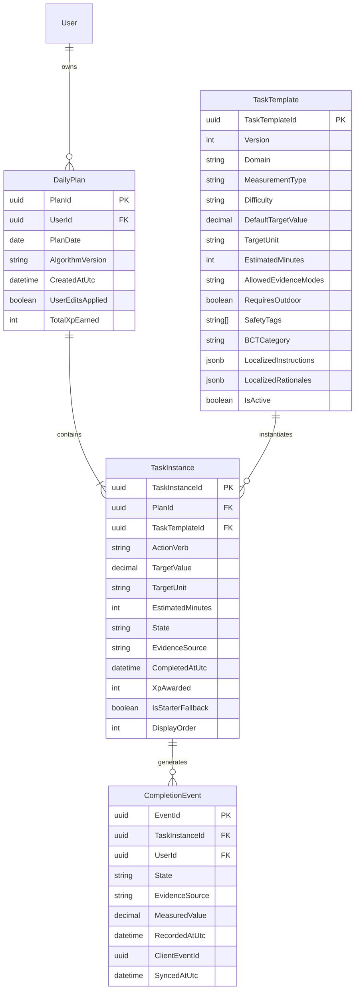
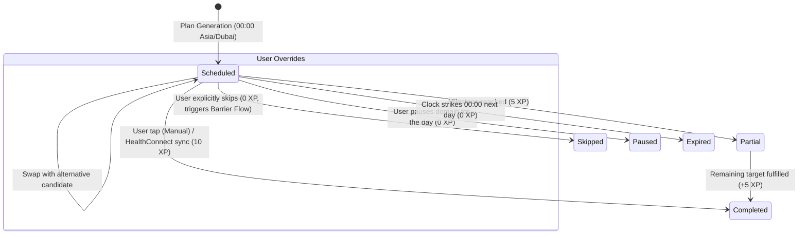

# Data Model: Daily Plan Generation & Action Engine

**Feature**: `002-daily-plan-and-action-engine`  
**Status**: Ready  
**Date**: 2026-11-15  
**Constitution**: Adheres strictly to [constitution.md](file:///c:/Users/Vignesh/OneDrive/Desktop/Gibo/.specify/memory/constitution.md)

---

## 1. Domain Entities & Aggregate Roots

---

## 2. Entity Details & Invariants

### 2.1 Aggregate Root: `DailyPlan`
Represents the container of curated health micro-habits for a specific calendar date and user.

- **Properties**:
  - `PlanId` (`Guid`, PK)
  - `UserId` (`Guid`, FK to `User`)
  - `PlanDate` (`DateOnly`): Calendar date in the user's active timezone (`Asia/Dubai`).
  - `AlgorithmVersion` (`string`): e.g. `"v2.1-5factor"`.
  - `UserEditsApplied` (`bool`): Set to `true` if user manually edited targets or swapped tasks.
  - `CreatedAtUtc` (`DateTime`)
  - `Tasks` (`IReadOnlyCollection<TaskInstance>`): 1 to 3 actions.
- **Invariants**:
  - A user can have at most **one** `DailyPlan` per calendar date (unique index on `(UserId, PlanDate)`).
  - The count of active tasks in a plan MUST NOT exceed `UserPreference.MaxDailyActions` (clamped between 1 and 3).
  - If `UserEditsApplied == true`, automated background engine recalculations are forbidden from overriding tasks.

### 2.2 Entity: `TaskTemplate`
Curated, clinician-reviewed master blueprint. Immutable once published; revisions increment `Version`.

- **Properties**:
  - `TaskTemplateId` (`Guid`, PK)
  - `Version` (`int`): Revisions create a new version record.
  - `Domain` (`GoalDomain` Enum: `Movement`, `SleepRoutine`, `Nutrition`).
  - `MeasurementType` (`MeasurementType` Enum: `DurationMinutes`, `StepCount`, `Repetitions`, `BooleanCheck`, `ServingCount`).
  - `Difficulty` (`TaskDifficulty` Enum: `Starter`, `Standard`, `Advanced`).
  - `DefaultTargetValue` (`decimal`): e.g., 10 (minutes) or 1000 (steps).
  - `TargetUnit` (`string`): e.g., `"mins"`, `"steps"`, `"glasses"`.
  - `EstimatedMinutes` (`int`): Time commitment (typically 2 to 15 mins).
  - `AllowedEvidenceModes` (`EvidenceMode` Enum: `Manual`, `HealthConnect`, `Both`).
  - `RequiresOutdoor` (`bool`): If true, filtered out when `IndoorPreferred == true` or midday summer heat is active.
  - `SafetyTags` (`string[]`): Contraindication flags (e.g. `["HighImpact", "StairsOnly", "LateEvening"]`).
  - `BCTCategory` (`string`): Behaviour Change Technique taxonomy (e.g. `"ActionPlanning"`, `"HabitFormation"`, `"RestructuringEnvironment"`).
  - `LocalizedInstructions` (`Dictionary<string, string>`): Trilingual strings (`en`, `ar`, `hi`).
  - `LocalizedRationales` (`Dictionary<string, string>`): Trilingual "Why this fits you" templates.
  - `IsActive` (`bool`)

### 2.3 Entity: `TaskInstance`
An execution item instantiated in a user's daily plan for a specific date.

- **Properties**:
  - `TaskInstanceId` (`Guid`, PK)
  - `PlanId` (`Guid`, FK to `DailyPlan`)
  - `TaskTemplateId` (`Guid`, FK to `TaskTemplate`)
  - `ActionVerb` (`string`): e.g. `"Walk"`, `"Stretch"`, `"Hydrate"`.
  - `TargetValue` (`decimal`): May be customized by user or engine.
  - `TargetUnit` (`string`)
  - `EstimatedMinutes` (`int`)
  - `State` (`TaskState` Enum: `Scheduled`, `Completed`, `Partial`, `Skipped`, `Expired`, `Paused`).
  - `EvidenceSource` (`CompletionEvidenceSource?` Enum: `Manual`, `HealthConnect`).
  - `CompletedAtUtc` (`DateTime?`)
  - `XpAwarded` (`int`): Exactly 10 for full completion, 5 for partial, 0 for skipped/expired.
  - `IsStarterFallback` (`bool`): True if user received the minimal 5-minute starter version.
  - `DisplayOrder` (`int`): 1, 2, or 3.

### 2.4 Entity: `CompletionEvent`
Immutable, auditable receipt of task execution.

- **Properties**:
  - `EventId` (`Guid`, PK)
  - `TaskInstanceId` (`Guid`, FK to `TaskInstance`)
  - `UserId` (`Guid`, FK to `User`)
  - `State` (`TaskState`: `Completed` or `Partial`)
  - `EvidenceSource` (`CompletionEvidenceSource`: `Manual` or `HealthConnect`)
  - `MeasuredValue` (`decimal?`): e.g. 1,420 steps synced from device.
  - `RecordedAtUtc` (`DateTime`): Timestamp when event occurred on client.
  - `ClientEventId` (`Guid`): Client-generated UUID for offline deduplication.
  - `SyncedAtUtc` (`DateTime`): Timestamp when backend ingested the event.

---

## 3. State Machine & Transitions

---

## 4. Invariant Rules & Guardrails

1. **XP Equality**:
   - `TaskInstance.Complete(EvidenceSource.Manual)` MUST award **10 XP**.
   - `TaskInstance.Complete(EvidenceSource.HealthConnect)` MUST award **10 XP**.
   - Neither source grants higher XP or special leaderboard status (Principle V).
2. **Idempotency & Concurrent Sync**:
   - If a `CompletionEvent` with the same `ClientEventId` or `(TaskInstanceId, State == Completed)` already exists, the second request returns the existing record with `IsDuplicate = true` and awards 0 duplicate XP.
3. **Hard Exclusion Safety**:
   - Contraindicated tasks with matching safety tags MUST be rejected by the ranking query with an absolute boolean condition (`WHERE NOT (template.SafetyTags && user.AccessibilityTags)`).
4. **Offline Sync Reconciliation**:
   - In the event of clock skew, `RecordedAtUtc` is preserved for historical analytics, but `SyncedAtUtc` is stamped by the backend server clock.
