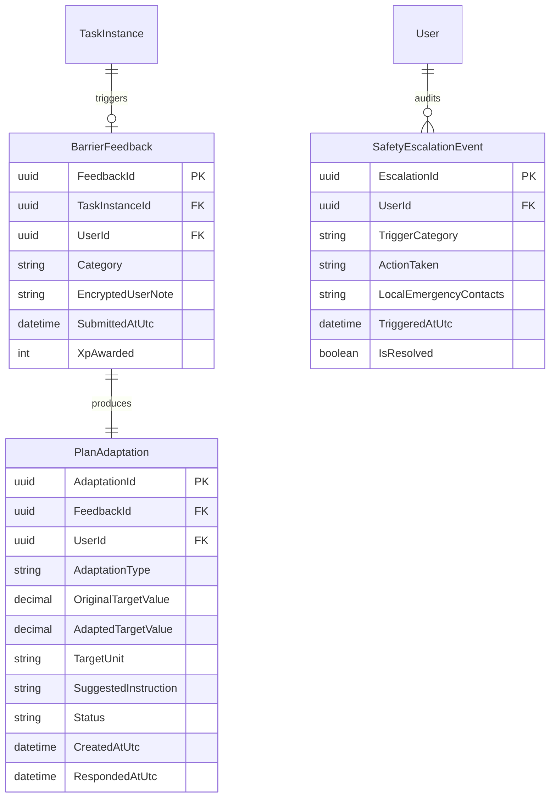
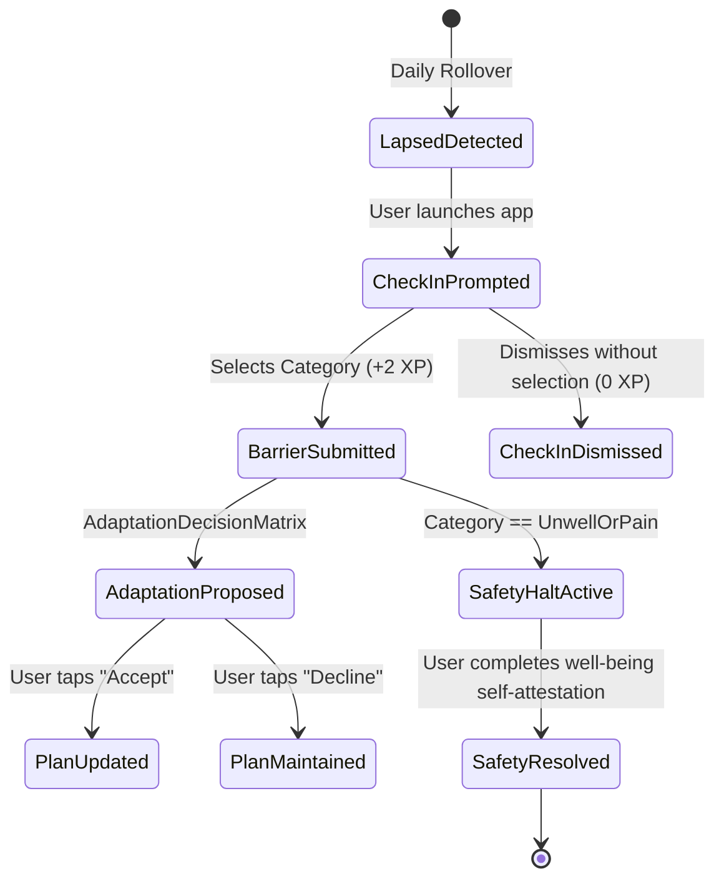

# Data Model: Adaptive Recovery Loop & Disruption Handling

**Feature**: `003-adaptive-recovery-loop`  
**Status**: Ready  
**Date**: 2026-11-18  
**Constitution**: Adheres strictly to [constitution.md](file:///c:/Users/Vignesh/OneDrive/Desktop/Gibo/.specify/memory/constitution.md)

---

## 1. Domain Entities & Relationships

---

## 2. Entity Details

### 2.1 Entity: `BarrierFeedback`
Represents the user's voluntary reflection on what prevented task completion.

- **Properties**:
  - `FeedbackId` (`Guid`, PK)
  - `TaskInstanceId` (`Guid`, FK to `TaskInstance`)
  - `UserId` (`Guid`, FK to `User`)
  - `Category` (`BarrierCategory` Enum: `TimingConflict`, `TooDifficult`, `LowEnergy`, `AccessOrWeather`, `Forgot`, `UnwellOrPain`, `PreferNotToSay`)
  - `EncryptedUserNote` (`string?`): Sensitive optional free-text encrypted using AES-256 envelope provider.
  - `SubmittedAtUtc` (`DateTime`)
  - `XpAwarded` (`int`): Invariant: Exactly **2 XP** for reflection.

### 2.2 Entity: `PlanAdaptation`
The structured recovery proposal generated by the decision matrix.

- **Properties**:
  - `AdaptationId` (`Guid`, PK)
  - `FeedbackId` (`Guid`, FK to `BarrierFeedback`)
  - `UserId` (`Guid`, FK to `User`)
  - `AdaptationType` (`AdaptationType` Enum: `ReduceTargetSize`, `RescheduleWindow`, `ReplaceWithLowEnergyAlternative`, `ConvertToIndoorAlternative`, `TemporaryPause`, `SafetyHalt`)
  - `OriginalTargetValue` (`decimal`)
  - `AdaptedTargetValue` (`decimal`)
  - `TargetUnit` (`string`)
  - `SuggestedInstruction` (`string`)
  - `Status` (`AdaptationStatus` Enum: `Proposed`, `Accepted`, `Declined`)
  - `CreatedAtUtc` (`DateTime`)
  - `RespondedAtUtc` (`DateTime?`)

### 2.3 Entity: `SafetyEscalationEvent`
Audit log recording health concern interceptions and emergency routing.

- **Properties**:
  - `EscalationId` (`Guid`, PK)
  - `UserId` (`Guid`, FK to `User`)
  - `TriggerCategory` (`string`): e.g. `"UnwellOrPain"`, `"RedFlagKeyword"`.
  - `ActionTaken` (`string`): `"CoachingHaltedAndReferralDisplayed"`.
  - `LocalEmergencyContacts` (`string`): `"Ambulance: 998, Telehealth: 800 50, Estijaba: 800 1717"`.
  - `TriggeredAtUtc` (`DateTime`)
  - `IsResolved` (`bool`): Set to `true` when user attests recovery.

---

## 3. State Machine & Transitions

