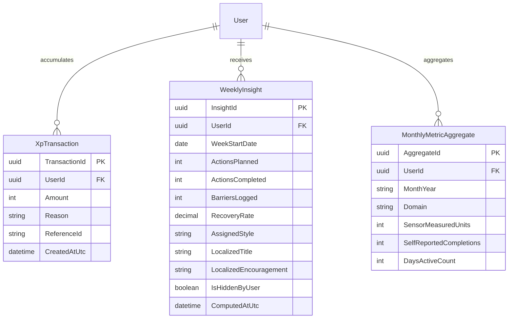

# Data Model: Purposeful Gamification & Weekly Gibo Styles

**Feature**: `004-gamification-and-weekly-styles`  
**Status**: Ready  
**Date**: 2026-11-18  
**Constitution**: Adheres strictly to [constitution.md](file:///c:/Users/Vignesh/OneDrive/Desktop/Gibo/.specify/memory/constitution.md)

---

## 1. Domain Entities & Relationships

---

## 2. Entity Details

### 2.1 Entity: `XpTransaction`
Immutable append-only ledger of earned effort.

- **Properties**:
  - `TransactionId` (`Guid`, PK)
  - `UserId` (`Guid`, FK to `User`)
  - `Amount` (`int`): Enforced invariant: `Amount > 0`. Zero and negative values rejected.
  - `Reason` (`XpReason` Enum: `TaskCompleted`, `PartialCompleted`, `ReflectionReward`, `WeeklyMilestone`)
  - `ReferenceId` (`string?`): Linked `TaskInstanceId` or `FeedbackId` for idempotency checking.
  - `CreatedAtUtc` (`DateTime`)

### 2.2 Entity: `WeeklyInsight`
Weekly aggregated constructive summary calculated on Sunday nights.

- **Properties**:
  - `InsightId` (`Guid`, PK)
  - `UserId` (`Guid`, FK to `User`)
  - `WeekStartDate` (`DateOnly`)
  - `ActionsPlanned` (`int`)
  - `ActionsCompleted` (`int`)
  - `BarriersLogged` (`int`)
  - `RecoveryRate` (`decimal`): Completions after a logged barrier / Total barriers.
  - `AssignedStyle` (`WeeklyStyleType` Enum: `ComebackChampion`, `CuriousExplorer`, `MindfulBalancer`, `SteadyBuilder`, `MomentumMaker`)
  - `LocalizedTitle` (`Dictionary<string, string>`)
  - `LocalizedEncouragement` (`Dictionary<string, string>`)
  - `IsHiddenByUser` (`bool`)
  - `ComputedAtUtc` (`DateTime`)

### 2.3 Entity: `MonthlyMetricAggregate`
Aggregated monthly trends separating data provenance.

- **Properties**:
  - `AggregateId` (`Guid`, PK)
  - `UserId` (`Guid`, FK to `User`)
  - `MonthYear` (`string`): e.g. `"2026-11"`
  - `Domain` (`GoalDomain` Enum: `Movement`, `SleepRoutine`, `Nutrition`)
  - `SensorMeasuredUnits` (`int?`): Total steps/minutes from Health Connect.
  - `SelfReportedCompletions` (`int`): Count of manually checked actions.
  - `DaysActiveCount` (`int`): Distinct active days in month.
