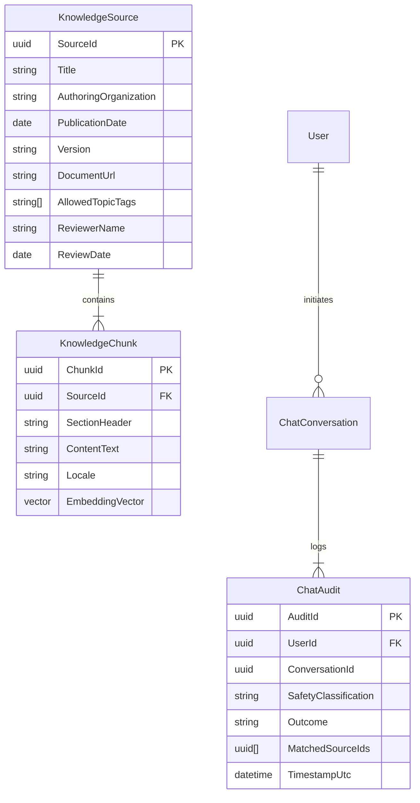

# Data Model: Grounded AI Wellness Assistant & Safety Guardrails

**Feature**: `005-grounded-ai-assistant`  
**Status**: Ready  
**Date**: 2026-11-18  
**Constitution**: Adheres strictly to [constitution.md](file:///c:/Users/Vignesh/OneDrive/Desktop/Gibo/.specify/memory/constitution.md)

---

## 1. Domain Entities & Relationships

---

## 2. Entity Details

### 2.1 Entity: `KnowledgeSource`
Master catalog of reviewed, approved medical and wellness evidence.

- **Properties**:
  - `SourceId` (`Guid`, PK)
  - `Title` (`string`): e.g. `"WHO Guidelines on Physical Activity and Sedentary Behaviour"`
  - `AuthoringOrganization` (`OrganizationType`: `WHO`, `DoH_AbuDhabi`, `GiboClinicalTeam`)
  - `PublicationDate` (`DateOnly`)
  - `Version` (`string`): e.g. `"2020.1"`
  - `DocumentUrl` (`string`)
  - `AllowedTopicTags` (`string[]`): `["Movement", "IndoorWalking", "HeatSafety"]`
  - `ReviewerName` (`string`)
  - `ReviewDate` (`DateOnly`)

### 2.2 Entity: `KnowledgeChunk`
Chunked, vectorized text passages for semantic retrieval.

- **Properties**:
  - `ChunkId` (`Guid`, PK)
  - `SourceId` (`Guid`, FK to `KnowledgeSource`)
  - `SectionHeader` (`string`)
  - `ContentText` (`string`)
  - `Locale` (`string`): `en`, `ar`, or `hi`
  - `EmbeddingVector` (`float[]` / `pgvector` 1536-dim or 768-dim)

### 2.3 Entity: `ChatAudit`
Privacy-preserving compliance telemetry.

- **Properties**:
  - `AuditId` (`Guid`, PK)
  - `UserId` (`Guid`, FK to `User`)
  - `ConversationId` (`Guid`)
  - `SafetyClassification` (`SafetyCategory`: `SafeWellness`, `EmergencyRedirect`, `DiagnosticBoundary`, `DisorderedEating`, `PromptInjection`)
  - `Outcome` (`ChatOutcome`: `AnsweredWithCitations`, `AbstainedLowConfidence`, `EmergencyHalt`)
  - `MatchedSourceIds` (`Guid[]`)
  - `TimestampUtc` (`DateTime`)
  - *Invariant*: Raw user query and LLM text are strictly omitted from `ChatAudit` to protect user privacy.
