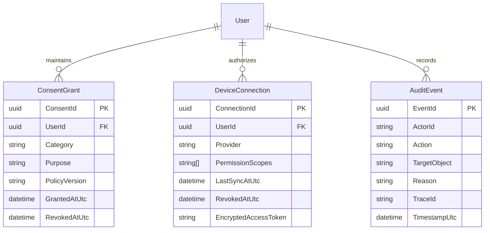

# Data Model: Privacy, Trust & Abu Dhabi Data Governance

**Feature**: `006-privacy-data-governance`  
**Status**: Ready  
**Date**: 2026-11-18  
**Constitution**: Adheres strictly to [constitution.md](file:///c:/Users/Vignesh/OneDrive/Desktop/Gibo/.specify/memory/constitution.md)

---

## 1. Domain Entities & Relationships

---

## 2. Entity Details

### 2.1 Entity: `ConsentGrant`
Granular legal authorization under UAE PDPL.

- **Properties**:
  - `ConsentId` (`Guid`, PK)
  - `UserId` (`Guid`, FK to `User`)
  - `Category` (`ConsentCategory`: `CoreProfile`, `HealthConnectSync`, `AssistantChatContext`, `AnonymousResearch`)
  - `Purpose` (`string`)
  - `PolicyVersion` (`string`): e.g. `"2026.1"`
  - `GrantedAtUtc` (`DateTime`)
  - `RevokedAtUtc` (`DateTime?`)
  - *Methods*: `Revoke()` sets `RevokedAtUtc = DateTime.UtcNow`.

### 2.2 Entity: `DeviceConnection`
Wearable provider authorization token record.

- **Properties**:
  - `ConnectionId` (`Guid`, PK)
  - `UserId` (`Guid`, FK to `User`)
  - `Provider` (`DeviceProvider`: `HealthConnect`)
  - `PermissionScopes` (`string[]`): `["StepsRecord.Read"]`
  - `LastSyncAtUtc` (`DateTime?`)
  - `RevokedAtUtc` (`DateTime?`)
  - `EncryptedAccessToken` (`string`): AES-256 encrypted OAuth/refresh token.

### 2.3 Entity: `AuditEvent`
Immutable security and regulatory audit log.

- **Properties**:
  - `EventId` (`Guid`, PK)
  - `ActorId` (`string`)
  - `Action` (`string`): `DATA_EXPORT_REQUESTED`, `ACCOUNT_DELETED`, `CONSENT_REVOKED`, `SAFETY_INTERCEPT`
  - `TargetObject` (`string`)
  - `Reason` (`string`)
  - `TraceId` (`string`)
  - `TimestampUtc` (`DateTime`)
